<!--
  GitHub Profile README
  GitHub: amreshkumar-dev-09
-->

# 👋 Hi, I'm Amresh Kumar

### ☕ Java Developer | Backend Development | Problem Solver

**Building projects • Practicing DSA • Learning Backend Development**

 

---

## 👨‍💻 About Me

- 🎓 Computer Science & Engineering student.
- ☕ Passionate about Java programming and backend development.
- 💻 Interested in building practical software applications.
- 🗄️ Working with JDBC, SQL and MySQL.
- 🧠 Practicing Data Structures and Algorithms.
- 🛠️ Experienced with Java development tools and testing fundamentals.
- 🚀 Continuously improving my problem-solving and development skills.

**Currently focusing on:** Java, DSA, SQL and Backend Development.

📫 **Email:** [amreshkumar96179@gmail.com](mailto:amreshkumar96179@gmail.com)

---

## 🛠️ Tech Stack & Tools

### Programming Languages

  

### Database & Backend

  
  

### Development Tools

  

### Testing

  

---

---

## ⭐ GitHub Profile Highlights

**Stars earned, commits and other GitHub statistics** are displayed in the GitHub Statistics card above.

---

## 🔥 Contribution Streak

---

## 📈 Contribution Activity & Commit Graph

---

## 🏆 GitHub Achievements

---

---

## 📊 GitHub Overview

---

## 📈 Contribution Activity

---

## 💻 Commit Activity

---

## 💡 Programming Languages

---

## 📁 Repository Analytics

## 🚀 Featured Projects

**Explore my projects and development work:**

> My best projects are highlighted in the pinned repositories section of my GitHub profile.

---

## 💻 Coding Profiles

---

## 🌐 Connect With Me

---

### 💡 "Consistency is the key to becoming a better developer."

**Thanks for visiting my profile!**

⭐ Feel free to explore my repositories and connect with me.

